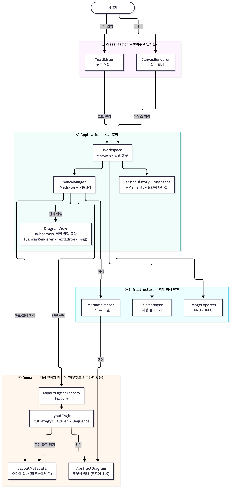
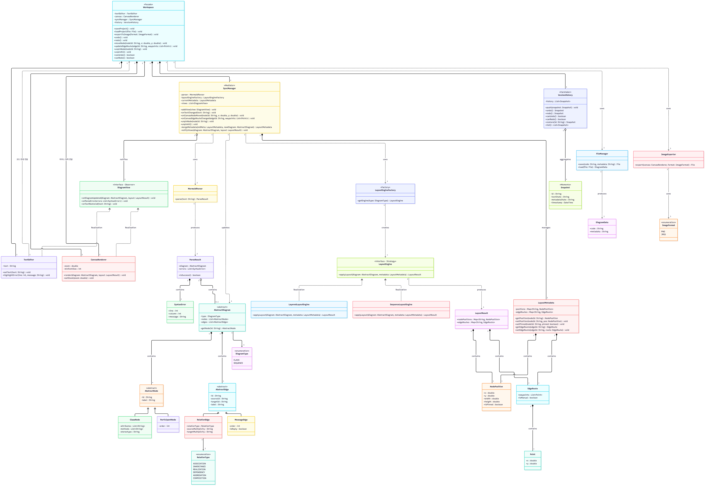
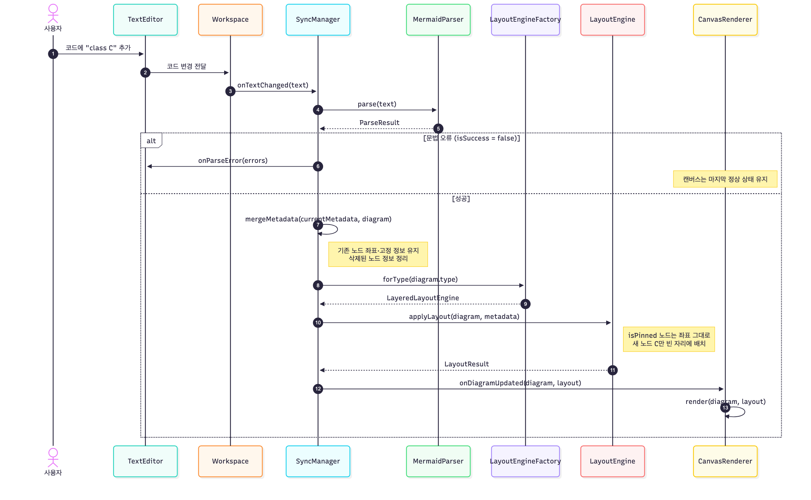
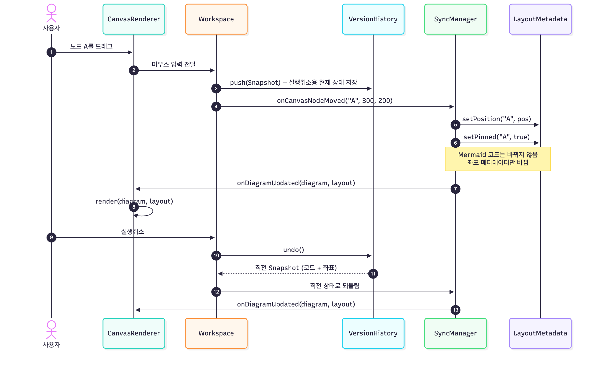

# UMLet × Mermaid 도구 아키텍처 · 디자인 패턴 설계서

| 항목 | 내용 |
| --- | --- |
| 작성일 | 2026-10-14 |
| 기준 다이어그램 | 팀 병합 클래스 다이어그램 10/14 수정본 (`UMLet-Mermaid-클래스다이어그램-팀병합-1014`) |
| 관련 문서 | 요구사항 명세서 v0.2, 유스케이스 다이어그램 |
| 독자 | 중간고사 후 재배치되어 개발을 맡을 팀원 |

> **이 문서의 목적:** 회의에 참석하지 않은 사람도 이 문서만 읽고 ① 프로그램이 어떤 덩어리로 나뉘는지, ② 각 클래스가 왜 그렇게 생겼는지(패턴), ③ 자기가 맡은 모듈이 다른 모듈과 어떻게 주고받는지를 알 수 있게 한다.

---

## 1. 한 문장 요약

**"무엇이 있나"는 코드에서, "어디에 있나"는 마우스에서 온다. 둘은 따로 저장하고, SyncManager가 둘을 합쳐 화면에 그린다.**

이 원칙은 교수님 인터뷰에서 나왔다.
- 객체 생성·관계 정의는 코드로, 이동은 마우스로 한다. (인터뷰 추가 요구사항)
- Mermaid 문법에 위치 정보를 추가하지 않는다. (인터뷰 Q9)
- 새 객체가 생겨도 기존 객체 위치는 유지한다. (인터뷰 Q3)

---

## 2. 아키텍처

### 2.1 아키텍처 스타일: 4계층 구조

| 계층 | 맡는 일 | 클래스 |
| --- | --- | --- |
| ① Presentation | 보여주고 입력받기만 한다. 데이터를 직접 바꾸지 않는다. | TextEditor, CanvasRenderer |
| ② Application | 입력을 받아 어떤 순서로 처리할지 정한다. | Workspace, SyncManager, DiagramView, VersionHistory, Snapshot |
| ③ Infrastructure | 바깥 형식(Mermaid 텍스트, 파일, 이미지)과 내부 데이터를 서로 바꾼다. | MermaidParser, ParseResult, SyntaxError, FileManager, DiagramData, ImageExporter, ImageFormat |
| ④ Domain | 다이어그램 데이터와 배치 규칙. 이 도구의 핵심이다. | AbstractDiagram 계층, DiagramType, RelationType, LayoutMetadata, NodePosition, EdgeRoute, Point, LayoutEngine 계층, LayoutEngineFactory, LayoutResult |

### 2.2 계층 규칙
1. **화살표는 아래로만 간다.** 위 계층은 아래 계층을 부를 수 있지만, 아래 계층은 위 계층을 모른다.
   - 예: LayoutEngine(④)은 CanvasRenderer(①)의 존재를 모른다.
2. **Domain(④)은 아무것도 의존하지 않는다.** 화면이나 파일 형식이 바뀌어도 배치 규칙은 고치지 않아도 된다.
3. **아래에서 위로 알릴 때는 인터페이스를 쓴다.** SyncManager(②)가 화면(①)에 결과를 알릴 때는 CanvasRenderer를 직접 부르지 않는다. ②에 있는 `DiagramView` 인터페이스를 부른다(Observer 패턴, 3.3절).

### 2.3 이렇게 나눈 이유
| 이유 | 설명 |
| --- | --- |
| 역할 분리(인터뷰) | 코드 입력과 마우스 입력이 서로 다른 길로 들어오지만, 모두 Application 계층에서 한 번에 정리된다. |
| 분업 | 계층·모듈 경계가 곧 담당자 경계가 된다(6장). 인터페이스만 지키면 각자 따로 개발할 수 있다. |
| 테스트 | Domain은 화면 없이 테스트할 수 있다. 예: "고정 노드 좌표가 유지되는가"를 화면 없이 확인한다. |

### 2.4 두 가지 데이터 흐름
| | 코드를 고쳤을 때 | 마우스로 옮겼을 때 |
| --- | --- | --- |
| 시작 | TextEditor | CanvasRenderer |
| 경로 | Workspace → SyncManager → MermaidParser → 좌표 병합 → LayoutEngine → 화면 | Workspace → SyncManager → LayoutMetadata → 화면 |
| 바뀌는 것 | 다이어그램 구조(AbstractDiagram) | 좌표·고정 여부(LayoutMetadata)만 |
| Mermaid 코드 | 사용자가 고친 대로 | **한 글자도 안 바뀜** |
| 시간 목표 | 1초 이내(NFR-01), 반영 300ms 이내(FR-03-1) | 300ms 이내(NFR-02) |
| 시퀀스 다이어그램 | `시퀀스-코드수정.png` | `시퀀스-드래그.png` |

---

## 3. 디자인 패턴

클래스 이름 위의 `«Facade»`, `«Strategy»` 등이 패턴 표시다.

### 3.1 패턴 요약표
| 패턴 | 적용 클래스 | 해결하는 문제 | 패턴이 없으면 | 관련 요구사항 |
| --- | --- | --- | --- | --- |
| **Facade** | Workspace | 화면이 SyncManager, VersionHistory, FileManager, ImageExporter를 각각 알아야 한다. | 화면 코드가 내부 클래스 6~7개에 얽혀, 내부를 바꿀 때마다 화면도 고쳐야 한다. | 전체 |
| **Mediator** | SyncManager | 코드 변경과 마우스 변경이 파서·레이아웃·메타데이터·화면에 모두 영향을 준다. | TextEditor와 CanvasRenderer가 서로를 직접 호출해 순서가 꼬인다. | FR-03-1, FR-03-2 |
| **Observer** | DiagramView (CanvasRenderer, TextEditor가 구현) | 배치가 끝나면 여러 화면에 알려야 하지만, SyncManager가 화면 클래스에 의존하면 안 된다. | Application 계층이 Presentation을 직접 알게 되어 계층 규칙이 깨진다. | FR-03-1, FR-01-3 |
| **Strategy** | LayoutEngine (LayeredLayoutEngine, SequenceLayoutEngine) | 클래스 다이어그램과 시퀀스 다이어그램은 배치 방식이 완전히 다르다. | SyncManager 안에 `if (CLASS) ... else if (SEQUENCE) ...`가 생기고, 배치 코드가 한 덩어리로 커진다. | FR-04-1, FR-08-1 |
| **Factory** | LayoutEngineFactory | 다이어그램 종류에 맞는 엔진을 골라야 한다. | 엔진을 고르는 코드가 여러 곳에 흩어진다. | FR-04-1 |
| **Memento** | Snapshot(기록), VersionHistory(보관) | 실행취소·버전 복원을 하려면 "코드 + 좌표" 상태를 통째로 저장했다가 되돌려야 한다. | 되돌리기 위해 다른 클래스의 내부 필드를 직접 꺼내야 한다. | FR-02-8, FR-10-2 |

### 3.2 패턴별 설명

**Facade: Workspace**
- 화면은 Workspace의 메서드만 부른다: `moveNode`, `updateEdgeRoute`, `unpinNode`, `undo`, `redo`, `saveProject`, `loadProject`, `exportToImage`.
- 그 뒤에서 누가 일을 하는지는 Workspace가 정한다.

**Mediator: SyncManager**
- 코드 쪽(MermaidParser)과 배치 쪽(LayoutEngine, LayoutMetadata)은 서로 직접 대화하지 않고 SyncManager를 거친다.
- 처리 순서(파싱 → 좌표 병합 → 엔진 선택 → 배치 → 알림)는 SyncManager 한 곳에만 있다.
- `mergeMetadata()`가 이 도구의 핵심 기능이다. 다시 파싱해도 기존 노드의 좌표·고정 정보를 유지하고, 삭제된 노드의 정보는 정리한다.

**Observer: DiagramView**
- SyncManager는 `views: List<DiagramView>`에 등록된 화면들에 `onDiagramUpdated()`와 `onSyntaxError()`를 알린다.
- CanvasRenderer는 그림을 다시 그리고, TextEditor는 오류 줄을 표시한다.
- 나중에 화면이 추가돼도(예: 미리보기 창) SyncManager는 고치지 않는다.

**Strategy + Factory: LayoutEngine, LayoutEngineFactory**
- 공통 규약: `applyLayout(diagram, metadata)`.
- 두 엔진 모두 **`metadata`에서 `isPinned = true`인 노드의 좌표는 바꾸지 않는다.** 이 규칙은 인터페이스 수준의 약속이라, 엔진을 새로 추가해도 반드시 지켜야 한다(FR-04-2).
- `LayoutEngineFactory.getEngine(DiagramType)`이 CLASS면 Layered, SEQUENCE면 Sequence 엔진을 돌려준다.

**Memento: Snapshot, VersionHistory**
- Snapshot은 `textState`(Mermaid 코드)와 `metadataState`(좌표 JSON)를 함께 담는다.
- Workspace는 변경 직전에 `VersionHistory.push()`로 상태를 저장한다. `undo()`·`redo()`·`restore(id)`로 되돌린다.
- 대상이 노드 30개 규모라 상태를 통째로 저장해도 부담이 작다. 그래서 Command 패턴 대신 Memento 하나로 실행취소와 버전 기능을 함께 처리한다.
- FileManager도 같은 두 문자열(code, metadata)을 저장한다. 저장 형식이 하나로 통일된다.

### 3.3 검토했지만 쓰지 않은 패턴
| 패턴 | 쓰지 않은 이유 |
| --- | --- |
| Command (실행취소) | Memento로 충분하다. 30노드 규모라 상태 전체 저장이 단순하고 버그가 적다. 규모가 커지면 다시 검토한다. |
| Composite (중첩 도형) | UML 클래스·시퀀스 범위에는 중첩 그룹이 없다(인터뷰 Q6). |
| Singleton | 전역 객체가 필요 없다. Workspace가 모든 객체를 생성·소유한다. |

---

## 4. 클래스 다이어그램
- 패턴 표시본: `클래스다이어그램-패턴표시.png`
- 원본 코드: `UMLet-Mermaid-클래스다이어그램-팀병합-1014.mmd`

**읽는 법**
- Workspace와 TextEditor·CanvasRenderer 사이에 선이 두 개 있다.
  - ◆ 실선(합성): Workspace가 화면 객체를 소유한다.
  - 점선 화살표(의존): 화면이 입력을 Workspace에 전달한다.
- `«interface · Strategy»`처럼 표시된 클래스는 인터페이스이면서 해당 패턴의 역할을 한다.

---

## 5. 핵심 시나리오 (시퀀스 다이어그램)

### 5.1 코드 수정 → 부분 재배치

1. 사용자가 코드에 노드를 추가한다.
2. SyncManager가 파싱한다.
   - 오류가 있으면 TextEditor에 오류를 알리고, 캔버스는 마지막 정상 상태를 유지한다(FR-03-5).
   - 성공하면 `mergeMetadata`로 기존 좌표·고정 정보를 옮긴다.
3. Factory로 엔진을 고르고 `applyLayout`을 실행한다. 고정 노드는 그대로 두고 새 노드만 배치된다.
4. DiagramView로 화면에 알린다.

### 5.2 드래그 → 고정 → 실행취소

1. 사용자가 노드를 끌면 Workspace가 먼저 현재 상태를 Snapshot으로 저장한다.
2. SyncManager가 LayoutMetadata에 좌표를 쓰고 `isPinned = true`로 바꾼다. **Mermaid 코드는 바뀌지 않는다.**
3. 실행취소하면 직전 Snapshot으로 되돌린다.

---

## 6. 모듈 분할과 담당 (개발 분업 단위)

| 모듈 | 계층 | 클래스 | 외부에 제공하는 것 | 의존하는 모듈 | 요구사항 | 담당 |
| --- | --- | --- | --- | --- | --- | --- |
| M1 파서·모델 | ③④ | MermaidParser, ParseResult, SyntaxError, AbstractDiagram 계층, DiagramType, RelationType | `parse(text) → ParseResult` | 없음 | FR-01-1~3, FR-05, FR-08 | |
| M2 레이아웃 엔진 | ④ | LayoutEngine, LayeredLayoutEngine, SequenceLayoutEngine, LayoutEngineFactory, LayoutResult | `applyLayout(diagram, metadata) → LayoutResult` | M1, M3 | FR-04-1~3, NFR-01 | |
| M3 좌표 메타데이터 | ④ | LayoutMetadata, NodePosition, EdgeRoute, Point | 좌표·고정·간선경로 읽기/쓰기, JSON 변환 | M1 | FR-04-2·4·7, DF-02 | |
| M4 동기화·흐름 | ② | Workspace, SyncManager, DiagramView | 화면용 메서드 전체, `onDiagramUpdated` 알림 | M1, M2, M3, M6 | FR-03, NFR-02 | |
| M5 화면 | ① | TextEditor, CanvasRenderer | 화면, 입력 이벤트 | M4 | FR-01-4, FR-02-1·3, FR-07, NFR-07 | |
| M6 저장·버전·내보내기 | ②③ | VersionHistory, Snapshot, FileManager, DiagramData, ImageExporter, ImageFormat | 저장·불러오기, 실행취소·버전, PNG·JPEG 내보내기 | M3 | FR-09, FR-10, DF-01·03 | |

**개발 순서 제안:** 의존이 없는 것부터 만든다.
1. **M1, M3:** 의존이 없어서 바로 시작할 수 있다.
2. **M2:** M1, M3의 데이터 구조가 필요하다.
3. **M6:** M3에 의존한다. M2와 병행할 수 있다.
4. **M4:** 대부분의 모듈을 연결한다.
5. **M5:** M4의 메서드를 부른다. 화면 틀은 1단계부터 병행할 수 있다.

**모듈 간 약속:** 6장 표의 "외부에 제공하는 것"이 모듈 사이의 계약이다. 이 메서드 시그니처를 바꾸려면 그 모듈을 부르는 담당자와 먼저 합의한다.

---

## 7. 설계 미결 사항 (개발 전에 정할 것)

| ID | 내용 | 제안 |
| --- | --- | --- |
| D-01 | ~~ImageExporter가 CanvasRenderer를 의존해 계층 규칙에 어긋남~~ | **해결:** CanvasRenderer 객체 대신 화면에 그려진 SVG 요소를 넘긴다(`export(canvasSvg, format, scale)`). |
| D-02 | ~~Snapshot 적용 메서드 없음~~ | **해결:** `SyncManager.restore(snapshot)` 추가 |
| D-03 | ~~Snapshot 저장 시점~~ | **결정:** 드래그·간선 수정·고정 해제는 반영될 때마다 저장한다. 코드는 파싱에 성공하고 입력이 0.5초 멈췄을 때 저장한다(`Workspace.ts`). |
| D-04 | ~~좌표 저장 위치~~ | **결정:** 같은 파일 맨 끝 한 줄 `%% @umlmaid-layout {JSON}` |
| D-05 | ~~레이아웃 엔진 구현 방식~~ | **결정:** elkjs 사용 |
| D-06 | ~~실행 환경·언어~~ | **결정:** TypeScript + React + Vite (웹) |

---

## 부록. 파일 목록
| 파일 | 내용 |
| --- | --- |
| `diagrams/architecture.png` | 4계층 아키텍처와 패턴 위치 |
| `diagrams/class-patterns.png` / `.mmd` | 패턴 표시 클래스 다이어그램 |
| `diagrams/sequence-code-change.png` | 코드 수정 → 부분 재배치 |
| `diagrams/sequence-drag.png` | 드래그 → 고정 → 실행취소 |
